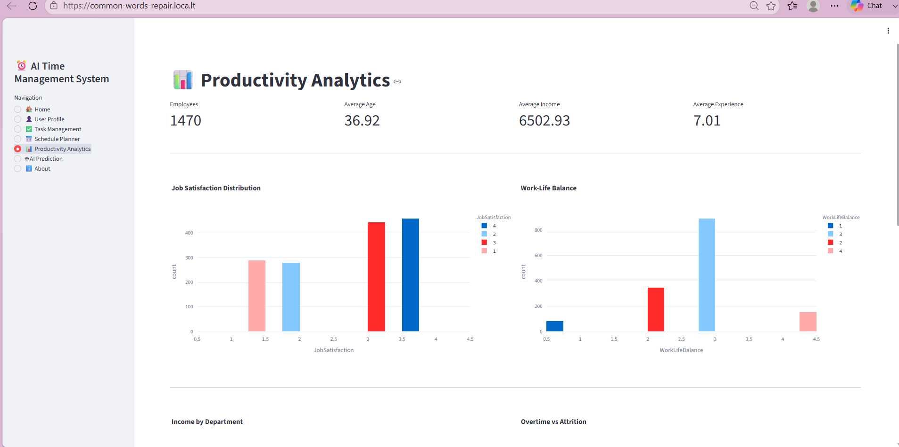
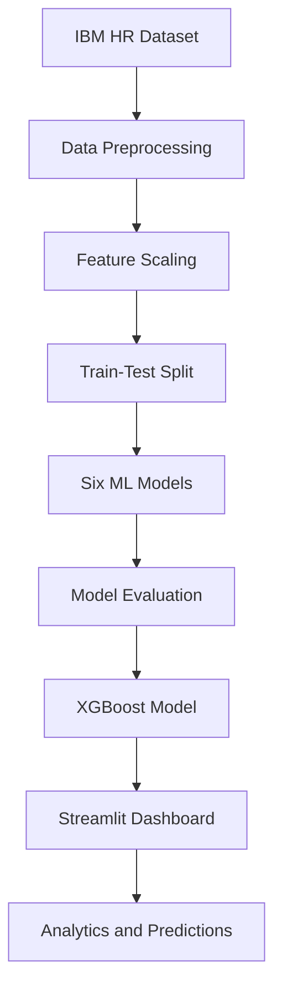

# AI Time Management System

A machine learning project with a Streamlit dashboard for productivity analytics and employee attrition prediction.

## Application Preview

**Live Demo:** [Open AI Time Management System](https://ai-time-management-system-ghyckmdcreywefimephe59.streamlit.app/)

## Features
- Interactive Streamlit dashboard
- Productivity analytics and visualizations
- Employee attrition prediction
- Comparison of machine learning models
- AI-driven insights and recommendations

## Technologies
Python, Streamlit, Pandas, Scikit-learn, XGBoost, Matplotlib

## System Architecture

## Project Structure
- `app.py` – Streamlit application
- `final.ipynb` – Google Colab notebook
- `requirements.txt` – Dependencies
- `model/` – Trained model files

## Dataset
IBM HR Employee Attrition Dataset

## Disclaimer
This project is an educational prototype.

## Screenshots

### Home

### AI Prediction

